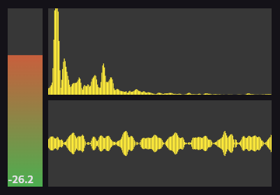

A low-level audio recorder plugin that uses miniaudio as the backend and supports all the platforms. It can detect silence and save to a WAV audio file. Audio wave and FFT data can be obtained in real-time as for the volume level.

[](https://pub.dev/packages/very_good_analysis)

|Linux|Windows|Android|MacOS (under test)|iOS (under test)|web (WASM compatible)|
|:-:|:-:|:-:|:-:|:-:|:-:|
|💙|💙|💙|💙|💙|💙|

## 🌟 Key Features:
- **Cross-platform**: Supports Linux, Windows, Android, MacOS, iOS, and web.
- **High performance**: Built using the fast and efficient miniaudio C library with FFI.
- **WAV or Ogg Opus Recording**: Record in WAV or Ogg Opus format with pause functionality.
- **Choose Data Type**: samplerate, mono or stereo, audio format (u8, s8, s16le, s24le, s32le or f32le).
- **Device Flexibility**: Choose your recording device.
- **Stream audio data**: Listen to PCM or Opus audio data stream.
- **Silence Detection**: Automatically detects silence via callback or Stream.
- **Customizable Silence Threshold**: Define what’s considered “silence” for your recordings.
- *Adjustable Pause Timing**: Set how long silence lasts before pausing, and how soon to resume recording.
- **Real-time Audio Metrics**: Access volume, audio wave, and FFT data in real-time.
- **Device & Microphone Lifecycle Notifications**: Listen to `deviceNotificationEvents` for hardware route changes, disconnects, and OS interruptions (e.g. phone calls).
- **Auto Gain**: Experimental Auto Gain filter.
- **Cross Platform**: Supports all platforms with WASM support for the web.

## 🚀 Setup
After setting up permission for you Android, MacOS or iOS, in your app, you will need to ask for permission to use the microphone maybe using [permission_handler](https://pub.dev/packages/permission_handler) plugin.
https://pub.dev/packages/permission_handler

#### Android
Add the permission in the `AndroidManifest.xml`.
```
<uses-permission android:name="android.permission.RECORD_AUDIO" />
```

### 🎛️ Platform Input Presets (Hardware & Browser Audio Processing)

Operating systems and browsers provide native hardware DSP and preprocessing pipelines (e.g. Acoustic Echo Cancellation, Automatic Gain Control, Noise Suppression). `flutter_recorder` allows configuring these directly in `init()`:

```dart
await Recorder.instance.init(
  // Android hardware capture preset (OpenSL / AAudio DSP)
  androidInputPreset: AndroidInputPreset.voiceCommunication,

  // iOS AVAudioSession preset (Apple hardware VoiceProcessingIO / Measurement)
  iosInputPreset: IosInputPreset.voiceCommunication,

  // Web Audio constraints (getUserMedia echoCancellation, autoGainControl, noiseSuppression)
  webInputPreset: WebInputPreset.unprocessed,
);
```

#### Android (`AndroidInputPreset`)
- `voiceCommunication`: Requests hardware Acoustic Echo Cancellation (AEC), AGC, and noise suppression tuned for VoIP/telephony.
- `voiceRecognition`: Tuned for speech-to-text; applies noise reduction while avoiding aggressive AGC volume distortion.
- `camcorder`: Tuned for video recording with directional microphone selection and balanced gain.
- `unprocessed`: Bypasses device DSP / manufacturer effects for clean, unprocessed audio capture.
- `generic`: System default recording source.

#### iOS (`IosInputPreset`)
- `voiceCommunication`: Configures `AVAudioSessionModeVoiceChat` with Apple hardware VoiceProcessingIO (hardware AEC and AGC). Avoids the need for external `audio_session` configuration.
- `videoChat`: Configures `AVAudioSessionModeVideoChat` with Apple voice processing optimized for video calls and speakerphone.
- `speechRecognition`: Configures `AVAudioSessionModeMeasurement` with minimal hardware gain distortion for speech-to-text.
- `unprocessed`: Configures `AVAudioSessionModeMeasurement` with flat frequency response and zero gain coloring for raw DSP analysis.
- `generic`: Configures standard `AVAudioSessionCategoryPlayAndRecord` with default system routing.
- If omitted (`null`), the active `AVAudioSession` is left untouched, preserving external session management (e.g. `audio_session` package).

#### Web (`WebInputPreset`)
- `unprocessed` *(Default)*: Disables browser AEC, AGC, and Noise Suppression (`{echoCancellation: false, autoGainControl: false, noiseSuppression: false}`). Prevents browser "volume pumping" / gating so raw audio reaches your app.
- `voiceCommunication`: Enables browser AEC, AGC, and Noise Suppression (`{echoCancellation: true, autoGainControl: true, noiseSuppression: true}`).
- `voiceRecognition`: Enables browser AGC and Noise Suppression without AEC (`{echoCancellation: false, autoGainControl: true, noiseSuppression: true}`).
- `noiseSuppression`: Enables only browser Noise Suppression (`{noiseSuppression: true}`).
- `echoCancellation`: Enables only browser Echo Cancellation (`{echoCancellation: true}`).

#### macOS
On macOS, CoreAudio HAL captures raw, unprocessed audio from the selected input device by default. System-wide "Voice Isolation" and "Wide Spectrum" Mic Modes in macOS Sonoma/Sequoia can be selected by the user in the macOS menu bar / Control Center.

---

#### MacOS, iOS Permissions
Add the permission in `Runner/Info.plist`.
```xml
<key>NSMicrophoneUsageDescription</key>
<string>Some message to describe why you need this permission</string>
```

on **MacOS** :

In capabilities, activate "Audio input" in debug and release schemes or add in `macos/Runner/*.entitlements` files:
```xml
<key>com.apple.security.device.audio-input</key>
<true/>
```

#### Linux

`flutter_recorder` uses ALSA for Linux audio capture. The ALSA development package is needed to build (for example `sudo apt install libasound2-dev`).

By default, Linux builds bundle the prebuilt Ogg, Opus and SpeexDSP libraries shipped with this package, so nothing else needs to be installed on the build machine or on the user's machine. The prebuilt libraries are available for x86_64 only: on other architectures use the system libraries as described below.

#### Using system Xiph libraries (Linux, macOS, Windows)

The native code is built by a Dart build hook (`hook/build.dart`), which by default links the prebuilt Ogg, Opus and SpeexDSP libraries shipped with this package. On desktop platforms you can link the libraries installed in the build environment instead, which is what Linux distributions and Flatpak runtimes usually require.

Add the platforms you need to your application's `pubspec.yaml`:

```yaml
hooks:
  user_defines:
    flutter_recorder:
      linux_use_system_xiph: true
      macos_use_system_xiph: true
      windows_use_system_xiph: true
```

`<platform>_use_system_libs` is accepted as an alias, so the same key names work for `flutter_soloud`. The values must be `true` or `false`; anything else stops the build with an error.

> **Important:** In this mode the libraries are **not bundled** with your app: they must also be installed wherever the app runs. This fits distribution packages and Flatpak, where the runtime provides them. For an app you ship directly to users, keep the default prebuilt libraries.

> **Note:** If your app also uses `flutter_soloud`, enable the system libraries in both packages. Otherwise `flutter_recorder` loads the Ogg and Opus libraries bundled by `flutter_soloud` instead of the system ones.

##### Linux

The libraries are located with `pkg-config`. Install it and the development packages in the build environment:

- **Debian / Ubuntu / Linux Mint**:
  ```bash
  sudo apt install pkg-config libogg-dev libopus-dev libspeexdsp-dev libasound2-dev
  ```

- **Fedora / RHEL**:
  ```bash
  sudo dnf install pkgconf-pkg-config libogg-devel opus-devel speexdsp-devel alsa-lib-devel
  ```

- **Arch Linux / Manjaro**:
  ```bash
  sudo pacman -S pkgconf libogg opus speexdsp alsa-lib
  ```

- **openSUSE**:
  ```bash
  sudo zypper install pkg-config libogg-devel libopus-devel speexdsp-devel alsa-devel
  ```

- **Alpine Linux**:
  ```bash
  sudo apk add pkgconf libogg-dev opus-dev speexdsp-dev alsa-lib-dev
  ```

At runtime the target system needs the matching runtime packages (for example `libogg0`, `libopus0` and `libspeexdsp1` on Debian).

##### macOS

The libraries are located with `pkg-config` when it is installed, then in the Homebrew and MacPorts prefixes (`/opt/homebrew`, `/usr/local`, `/opt/local`):

```bash
brew install libogg opus speexdsp
```

Homebrew installs libraries for the host architecture only, while Flutter builds macOS release apps for both `arm64` and `x86_64`. A build for an architecture the libraries do not contain stops with an error: provide universal libraries, or build only for the host architecture.

The resulting app loads the libraries from their install location, so it only runs on machines where they are installed at the same path.

##### Windows

The libraries are located in a [vcpkg](https://vcpkg.io) installation, searched in `%VCPKG_ROOT%`, `C:\vcpkg` and `C:\tools\vcpkg`:

```bat
vcpkg install libogg opus speexdsp --triplet x64-windows
```

The triplet defaults to `x64-windows` (`arm64-windows` for ARM64 builds); set the `VCPKG_DEFAULT_TRIPLET` environment variable to use another one.

With a dynamic triplet, the DLLs in `installed\<triplet>\bin` are not copied into your app: make them available next to the executable or on `PATH`.

#### Web (Single-Threaded & Multi-Threaded AudioWorklet)

`flutter_recorder` supports both **Single-Threaded (ST)** and **Multi-Threaded (MT)** WebAssembly builds:
- **Multi-Threaded (AudioWorklet)**: Offloads audio capture, DSP filtering, and Opus encoding to a dedicated Web Audio `AudioWorklet` / `pthread` thread for high-performance, glitch-free audio without frame drops.
- **Single-Threaded**: Fallback mode for environments where `SharedArrayBuffer` is unavailable.

##### 1. Configure `web/index.html`
Add `init_recorder_module.dart.js` to your `web/index.html`. It automatically picks the right WASM build flavor (MT or ST) at runtime and dynamically loads the required JS glue:

```html
<script src="assets/packages/flutter_recorder/web/init_recorder_module.dart.js" defer></script>
```

##### 2. Enabling Multi-Threaded Mode (COOP/COEP Headers)
Multi-threaded WASM requires `SharedArrayBuffer`, which modern browsers only enable in cross-origin isolated contexts. Ensure your web server serves the following HTTP response headers:
```http
Cross-Origin-Opener-Policy: same-origin
Cross-Origin-Embedder-Policy: require-corp
```

##### 3. Running & Building with WASM
Run or build your app enabling Dart to WebAssembly compilation via `--wasm`:

```bash
# Run locally with WASM:
flutter run -d chrome --wasm \
  --web-browser-flag '--disable-web-security' \
  -t lib/main.dart --release

# Build for production with WASM:
flutter build web --wasm --release
```

##### 🌐 Web Audio Preprocessing (AEC, AGC, Noise Suppression)
By default, web browsers automatically enable their own built-in **Automatic Gain Control (AGC)**, **Acoustic Echo Cancellation (AEC)**, and **Noise Suppression** on the microphone. In loopback and custom filter setups, browser AGC can cause an unwanted volume pumping / oscillation effect.

You can configure or disable these browser-level filters at any time using:
```dart
// Configure browser audio constraints (web only, no-op on other platforms):
Recorder.instance.setWebAudioConstraints(
  echoCancellation: false,  // Disable browser AEC (e.g. to use flutter_recorder's native AEC)
  autoGainControl: false,   // Disable browser AGC to eliminate volume pumping/oscillation
  noiseSuppression: false,  // Disable browser noise suppression for raw audio capture
);
```
> **Note:** In Chromium-based browsers, the browser's WebRTC audio processing graph is instantiated when `getUserMedia()` is first called. Dynamically changing these flags while recording (via `applyConstraints`) may be ignored by the browser. For guaranteed effect, call `setWebAudioConstraints()` **before** calling `Recorder.instance.init()` or starting capture.


#### Linux
- [`GStreamer`](https://gstreamer.freedesktop.org/documentation/installing/index.html?gi-language=c) is installed by default on most distributions, but if not, please [install it](https://gstreamer.freedesktop.org/documentation/installing/on-linux.html?gi-language=c) through your distribution's package manager.
- Installing Flutter using `snap` could cause compilation problems with native plugins. The only solution is to uninstall it with `sudo snap remove flutter` and install it the [official way](https://flutter-ko.dev/get-started/install/linux).

## 🤖 AI Agent Skills

`flutter_recorder` includes bundled **Agent Skills** (`SKILL.md` instruction files) to help AI coding agents (Claude, Cursor, Gemini, GitHub Copilot, Cline, Codex, OpenCode, etc.) generate correct, high-performance code for all features of this audio recorder plugin.

Install or update the skills in your project by running:

```bash
dart run flutter_recorder:skills
```

To check whether installed skills are up to date without modifying any files:

```bash
dart run flutter_recorder:skills --check
```

## 🛠️ Usage Example
```dart
import 'package:permission_handler/permission_handler.dart';
[...]
/// If you are running on Android, MacOS or iOS, ask the permission to use the microphone:
if (defaultTargetPlatform == TargetPlatform.android ||
    defaultTargetPlatform == TargetPlatform.iOS ||
    defaultTargetPlatform == TargetPlatform.macOS) {
    Permission.microphone.request().isGranted.then((value) async {
    if (!value) {
        await [Permission.microphone].request();
    }
});

/// Initialize the capture device and start it:
try {
    Recorder.instance.init();
    Recorder.instance.start();
} on Exception catch (e) {
    debugPrint('init() error: $e\n');
}
/// On Web platform it is better to initialize and wait the user to give
/// mic permission. Then use `start()` when it's needed.

// Start recording (WAV is the default):
Recorder.instance.startRecording(completeFilePath: 'audioCompleteFilenameWithPath.wav');

// Or record to Ogg Opus:
Recorder.instance.startRecording(
  completeFilePath: 'audioCompleteFilenameWithPath.opus',
  format: RecordingFormat.opusOgg,
);

/// Stop recording:
Recorder.instance.stopRecording();
```
**Tip**: Use `Recorder.instance.listCaptureDevices()` to see available devices and pass an optional `deviceID` to `init()`.
**Tip2**: Use the `format`, `sampleRate` and `channels` with the `init()` method to define recorder parameters.
**Tip3**: When recording with silence detection and want to record a little bit before the threshold db is reached, use the `setSecondsOfAudioToWriteBefore()` method.
**Tip4**: On Android, pass `androidInputPreset` to `init()` to compare capture presets such as `voiceRecognition`, `voiceCommunication`, `camcorder`, or `unprocessed`.


### 🔇 Silence Detection Example

Want to skip the silence? Here’s how to configure it:

```dart
Recorder.instance.setSilenceDetection(
    enable: true,
    onSilenceChanged: (isSilent, decibel) {
        /// Here you can check if silence is changed.
        /// Or you can do the same thing with the Stream
        /// [Recorder.instance.silenceChangedEvents]
    },
);
/// the silence threshold in dB. A volume under this value is considered to be silence.
Recorder.instance.setSilenceThresholdDb(-27);
/// the value in seconds of silence after which silence is considered as such.
Recorder.instance.setSilenceDuration(0.5);
/// Set seconds of audio to write before starting recording again after silence.
Recorder.instance.setSecondsOfAudioToWriteBefore(0.0);
```

***NOTE: this is only available when initializing the recorder with `PCMFormat.f32le` format.***

### 📊 Real-time Audio Visualization (Waveform & FFT)

The recorder provides a high-performance, SIMD-accelerated (via PFFFT) audio analysis pipeline with Blackman windowing and smoothing.

```dart
// 1. Listen to real-time audio visualization events:
Recorder.instance.audioVisualizationEvents.listen((AudioVisualizationData data) {
  // Number of channels in this packet (1 for mono/merged, 2+ for multi-channel)
  final channelCount = data.channelCount;

  // Waveform samples in range [-1.0, 1.0]
  final waveData = data.waveData; // or data.wave for all channels

  // FFT frequency bins in range [0.0, 1.0]
  final fftData = data.fftData; // or data.fft for all channels
});

// 2. Enable visualization:
Recorder.instance.setVisualizationEnabled(
  true,
  windowSize: 256, // Power of 2 between 128 and 8192
  kind: VisualizationKind.waveAndFft, // wave, fft, or waveAndFft
  channel: VisualizationChannel.merged, // merged (mono downmix), all, or channel index
);

// Optional: Configure FFT smoothing (0.0 to 1.0)
Recorder.instance.setFftSmoothing(0.6);

// Get current volume level in dB [-100, 0]:
double volume = Recorder.instance.getVolumeDb();
```



***NOTE: Audio visualization is available when initializing the recorder with `PCMFormat.f32le` format.***

### 📢 Audio data stream 


```dart
/// Listen to audio data stream. The data is received in Uint8List.
Recorder.instance.uint8ListStream.listen((data) {
    /// the [data] is of type `AudioDataContainer` and, whatever format is passed to
    /// the `init()` method, it is available with [data.rawData] which is of `Uint8List`
    /// type. This is useful if we want to write into a file.
    /// It is possible to convert audio data to the desired format using one of the
    /// `data.to[*]List` methods. Be aware that the conversion is compute expensive and
    /// should be avoided if possible initializing the recorder with the format
    /// desired.
});

/// Start streaming (PCM is the default):
Recorder.instance.startStreamingData();

/// Or stream encoded Opus packets:
Recorder.instance.startStreamingData(format: StreamingFormat.opus);

/// Stop streaming:
Recorder.instance.stopStreamingData();
```
> [!CAUTION]
> Audio data must be processed as it is received. To optimize performance, the same memory is used to store data for all incoming streams, meaning the data will be overwritten. Therefore, you must copy the data if you need to populate a buffer while it arrives.
> For example, when using **RxDart.bufferTime**, it will fill a **List** of `AudioDataContainer` objects, but when you attempt to read them, you will find that all the items contain the same data.

### 🎧 Device & Microphone Lifecycle Notifications

Hardware state changes and OS audio events can happen outside your app's direct control (e.g. unplugging headphones, system audio route changes, or incoming phone calls on iOS). You can listen to native device notifications via the `deviceNotificationEvents` broadcast stream:

```dart
Recorder.instance.deviceNotificationEvents.listen((RecorderDeviceNotification event) {
  switch (event) {
    case RecorderDeviceNotification.started:
      debugPrint('Microphone capture started.');
    case RecorderDeviceNotification.stopped:
      debugPrint('Microphone capture stopped.');
    case RecorderDeviceNotification.rerouted:
      debugPrint('Audio input route changed (e.g. headset connected/disconnected).');
    case RecorderDeviceNotification.interruptionBegan:
      debugPrint('OS audio interruption began (e.g. incoming call, Siri, alarm).');
    case RecorderDeviceNotification.interruptionEnded:
      debugPrint('OS audio interruption ended.');
    case RecorderDeviceNotification.unlocked:
      debugPrint('Audio device lock released.');
  }
});
```

### 🎚️ Auto Gain Filter

> [!WARNING]
> This is an experimental feature, may change in the future.

```
final Recorder recorder = Recorder.instance;
// Please look at the [Recorder.instance.autoGainFilter] doc to have a parameters overview.
final AutoGain autoGain = recorder.filters.autoGainFilter;

// You can now query or set parameters:
// For example with [autoGain.queryTargetRms] you can query the "human" name, `min`, `max` and `def` values.

// Set a new parameter value:
autoGain.targetRms.value = newValue;

// Get a new parameter value:
final value = autoGain.targetRms.value;
```
Writable parameters: `targetRMS`, `attackTime`, `releaseTime`, `gainSmoothing`, `maxGain`, `minGain`, `noiseFloorDb`, `headroomDb`.
Read-only metrics: `currentGain`, `inputRms`, `outputPeak`, `limiterClipCount`, `totalLimiterClipCount`, `lastFrameCount`.

### 🔇 Acoustic Echo Cancellation (AEC) & Loopback

`flutter_recorder` integrates real-time Acoustic Echo Cancellation powered by [SpeexDSP](https://github.com/xiph/speexdsp) ([Revised BSD License](https://github.com/xiph/speexdsp/blob/master/COPYING)) to remove loudspeaker feedback and room reflections from the microphone signal.

```dart
final recorder = Recorder.instance;

// 1. Activate the AEC filter
recorder.filters.echoCancellationFilter.activate();

// 2. Adjust parameters
recorder.filters.echoCancellationFilter.filterLengthMs.value = 150; // 10 to 500 ms
recorder.filters.echoCancellationFilter.denoiseEnabled.value = 1;    // 0 or 1
recorder.filters.echoCancellationFilter.denoiseLevelDb.value = -30;  // -60 to 0 dB
```

#### Choose Reference Audio Mode:

Depending on your application architecture, AEC can obtain its far-end speaker reference in two ways:

##### Mode A: Native Duplex Loopback (Karaoke / Sidetone)
```dart
// Routes mic audio directly to speakers/headphones in native C++ with near-zero latency (< 15ms)
recorder.setLoopback(enable: true);
```
- **Karaoke & In-Ear Monitoring**: Singers hear their own voice with zero delay while AEC prevents acoustic howling.
- **Microphone Sidetone**: Confidence monitoring for podcasters and streamers.

##### Mode B: External Playback Reference (VoIP / Gaming / Smart Assistants)
```dart
// Keep native loopback off so mic audio is not duplicated
recorder.setLoopback(enable: false);

// Capture loudspeaker audio from flutter_soloud (or your VoIP decoder) and feed it to AEC:
soloud.startMixerOutputStream(format: MixerOutputFormat.pcmF32le).listen((mixerData) {
  recorder.feedPlaybackData(mixerData, format: PCMFormat.f32le);
});
```
- **Voice Calls / Video Conferencing**: Eliminates remote caller echo when loudspeaker is active.
- **Gaming with Voice Chat**: Cancels background game music and SFX played via `flutter_soloud` from the chat mic.
- **Voice Assistants (Barge-In)**: Allows devices to hear user commands while actively playing music or responses.

---

## 📜 Third-Party Libraries & Licenses

- **[miniaudio](https://github.com/mackron/miniaudio)**: Public Domain / MIT-0 License
- **[SpeexDSP](https://github.com/xiph/speexdsp)**: [Revised BSD License (3-Clause BSD)](https://github.com/xiph/speexdsp/blob/master/COPYING) (Copyright © 2002–2008 Xiph.org Foundation, Jean-Marc Valin, CSIRO, et al.)
- **[Opus](https://github.com/xiph/opus)**: [BSD License](https://github.com/xiph/opus/blob/master/COPYING)
- **[Ogg](https://github.com/xiph/ogg)**: [BSD License](https://github.com/xiph/ogg/blob/master/COPYING)

